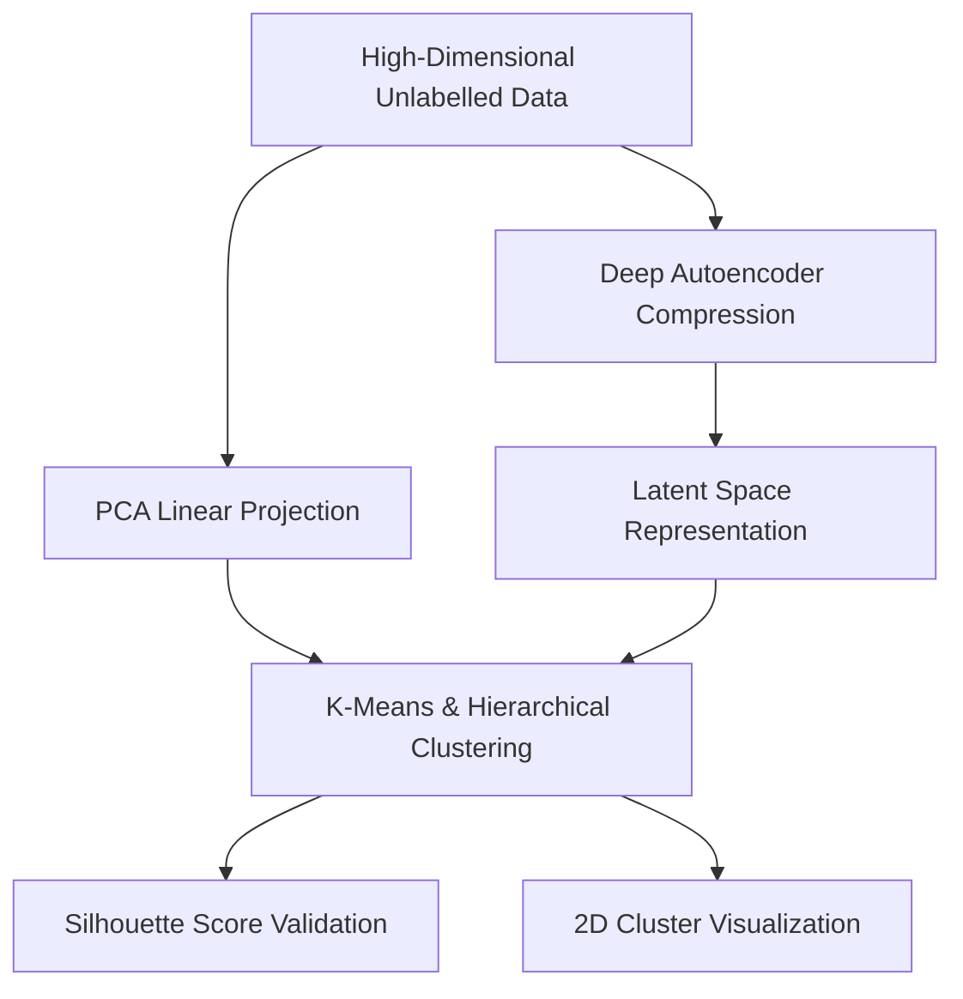

# Unsupervised Representation Learning and Deep Clustering

> Comparative unsupervised machine learning pipeline for clustering and dimensionality reduction.

[](https://github.com/sohailahmed-bsrh/unsupervised-deep-learning-pipeline)
[](https://sohail.devsil.com/projects.html)
[](https://sohail.devsil.com)

---

## Overview

High-dimensional unlabelled data obscures underlying cluster structures and patterns without dimensionality reduction.

This project provides an end-to-end, reproducible implementation engineered to solve this challenge through verified data transformations, reliable algorithms, and production-ready architecture.

---

## Key Features

- Principal Component Analysis (PCA) and t-SNE projection for manifold visualization
- K-Means and Hierarchical Agglomerative clustering with elbow-method validation
- Deep neural autoencoder architecture for non-linear latent feature compression
- Silhouette score analysis measuring cluster cohesion and separation

---

## System Architecture



---

## Technology Stack

| Technology | Version / Spec | Role in Architecture |
| :--- | :--- | :--- |
| **TensorFlow / Keras** | `2.12+` | Deep autoencoder training and latent space extraction |
| **Scikit-learn** | `1.3+` | PCA, K-Means clustering, and silhouette evaluation |
| **Pandas & NumPy** | `2.0+` | Data normalization and array operations |
| **Matplotlib** | `3.7+` | Cluster scatter plots and scree plots |

---

## Repository Structure

```text
unsupervised-deep-learning-pipeline/
|-- notebooks/
|   `-- Unsupervised_ML_&_Deep_Learning.ipynb
|-- data/
|-- .gitignore
|-- requirements.txt
`-- README.md
```

---

## Installation and Execution

### Prerequisites
- Python 3.10 or higher
- Git version control
- Virtual environment manager (`venv`)

### Setup Instructions
1. Clone the repository:
```bash
git clone https://github.com/sohailahmed-bsrh/unsupervised-deep-learning-pipeline.git
cd unsupervised-deep-learning-pipeline
```

2. Configure environment and dependencies:
```bash
python -m venv venv
source venv/bin/activate  # On Windows: venv\Scripts\activate
pip install -r requirements.txt
jupyter notebook notebooks/
```

---

## Interface and Verification
The system produces verifiable execution logs, prediction matrices, or interactive browser interfaces depending on the target mode. Verify operation by executing the commands specified above or inspecting the demonstration notebooks.

---

## Author and Contact
Developed by **Sohail Ahmed** — Full Stack AI Engineer & Machine Learning Specialist.
- **Portfolio:** [sohail.devsil.com](https://sohail.devsil.com)
- **GitHub:** [@sohailahmed-bsrh](https://github.com/sohailahmed-bsrh)
- **Email:** [sohail.bsrh@gmail.com](mailto:sohail.bsrh@gmail.com)
